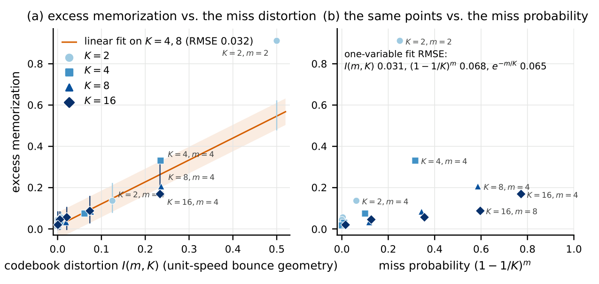

# Nearest-of-m World Models

**How Many Candidates Does a One-Step World Model Need? A Random-Codebook Account of Nearest-of-m Training on Frozen DINO Tokens**

YongHwi Song (School of Information and Communication Engineering, Chungbuk National University)

Code, results and reports behind the paper. The manuscript prepared for TMLR is in [paper/tmlr/](paper/tmlr/) (anonymous submission version, 2026-11-01).

## Summary

One-step stochastic world models avoid the mode averaging of deterministic feature predictors without the tens of network evaluations per step that diffusion and flow matching need. The simplest such objective is nearest-of-m matching (conditional implicit maximum likelihood estimation, IMLE): draw m candidate futures and pull only the one closest to the observed outcome toward it. We ask how large m has to be and when no m is enough, using one-step world models on frozen DINOv2/v3 patch tokens and benchmarks whose futures can be enumerated.

- **Coverage.** Under mode-like uncertainty, nearest-of-m with m = 16 covers the enumerated futures better than 50-step flow matching, two one-step flow generators (iMF, Shortcut) and an energy-score generator at matched parameter counts (±4%). On the non-repeating bounce benchmark A2-div, coverage / precision is 0.93 / 0.82 against 0.79 / 0.51 for FM-50, with about 30× lower latency (3.3 ms vs 107 ms). Rollouts stay on the token manifold where flow rollouts drift, whatever the number of integration steps.
- **Random-codebook view.** The nearest-of-m objective is the expected distortion of a random codebook of m draws from the generator. This single view predicts three things, and each prediction was written down before the corresponding runs.
  - *Memorization.* In contexts that never repeat, the model memorizes the realized outcome, and the incentive is the codebook's miss distortion I(m), not its miss probability: I(m, K) explains the excess memorization of K = 2 to 16 modes with RMSE 0.031, against 0.065 for any m/K rule (7 of 9 predictions within ±2σ; "m ≈ 2K" rejected). An energy-score generator does not escape by raising m (memorization index 0.87 at m = 8, 0.97 at m = 16), because its incentive does not depend on m.
  - *Flattening.* Mode probabilities flatten with m, matching a known optimum within 0.01 (asymmetric modes p = 0.79: mode share 0.82 / 0.65 / 0.57 at m = 2 / 4 / 16).
  - *Under-dispersion.* On continuous high-dimensional outcomes (BAIR robot video) the spread-to-error ratio rises only from 0.22 to 0.53 as m goes from 4 to 64, which bounds the method on real video.
- **Rollouts and planning.** Per-step matching on self-rollouts cuts 16-step error by a third on a stochastic Push-T variant, and an ablation separates its manifold benefit (self-rollout context) from its coverage benefit (matched selection). Planning success does not improve despite accurate risk estimates (imagined pit probability 0.36 vs true 0.33; FM-2 0.14), a negative result reported with its diagnosis: the simple CEM planner, not the model, is the bottleneck.

| Claim (fixed in `EXPERIMENT_DESIGN.md` before the main runs) | Outcome |
|---|---|
| C1: one-step multimodal prediction beats FM-50 and one-step generators | holds on A1, A2-div, A2-fix; Push-T precision only; BAIR out of scope |
| C2: the candidate budget m follows a law in the number of modes K | holds with a changed content: I(m) governs, "m ≈ 2K" rejected |
| C3: rollouts stay on the token manifold | holds on all three benchmarks, FM-50 included |
| C4: nearest-of-m memorizes realized outcomes in non-repeating contexts; m controls it | holds (3 seeds, 3 remedies); the energy score memorizes regardless of m |
| C5: planning benefits from the m free samples | success rate fails on both tasks; speed and risk-estimate accuracy hold |
| C6: sequential per-step matching reduces rollout error | holds (Push-T −33%, A1 moderate, A2 manifold only); mechanism split by ablation |

Predictions recorded before the runs: E12 (m law at K = 2, 16) 7 of 9; E15 (energy score) 5 of 5; E16 (sequential-matching ablation and seed reinforcement) 5 of 5. The full account is in [main/reports/final_verdict.md](main/reports/final_verdict.md).



## Repository layout

| Path | Contents |
|---|---|
| [RESEARCH_DESIGN.md](RESEARCH_DESIGN.md) | Research design v1 (2026-10-10): idea, research questions RQ1 to RQ5, planned contributions N0 to N4 |
| [EXPERIMENT_DESIGN.md](EXPERIMENT_DESIGN.md) | Experiment plan v2 (2026-10-11, after the feasibility study and E0): claims C1 to C6, recipes, benchmarks, baselines, metrics, run matrix |
| [main/code/imlewm/](main/code/imlewm/) | The package that was run: data generation, model, training (`train.py`), evaluation, memorization check, planning, probes |
| `main/code/*.sh`, `main/code/q*.txt` | Queue runner (`runq.sh`), chain scripts per block and the job lists exactly as queued |
| [main/code/diag/](main/code/diag/) | One-off diagnostic scripts run from the server root |
| [main/results/runs/](main/results/runs/) | Per-run outputs copied from the server (`eval.json`, `e3.json`, `log.jsonl`, mode-share and planning JSON; 222 runs) |
| [main/results/](main/results/) | `feasibility/` (summary and scatter figures of the feasibility study), `check/` (memorization checks), `e15_toy/` (CPU toy experiment), `logs/` (stdout of every job) |
| [main/reports/](main/reports/) | Block reports (feasibility, E0, E1, E2 to E6, E7 to E9, E11, A1 joint pilot, E12 to E14, E15, E16), the theory note `theory_m_law.md`, `novelty_analysis.md` and the final summary `final_verdict.md` |
| [main/reports/literature/](main/reports/literature/) | Four literature checks (2026-10-11, 10-16, 11-01) |
| [paper/](paper/) | TMLR manuscript source and PDF, the longer pre-proofreading version, outline, figure script and the manuscript-copy script (`paper/README.md`) |

Designs, reports and literature notes are written in Korean; code and comments are in English.

## Experiment blocks

| Block | Dates | What was run | Report |
|---|---|---|---|
| Feasibility | 10-10 to 10-11 | Synthetic bounce and push, screening of N0 to N4 | `feasibility_report.md` |
| E0 | 10-11 | Recipes and parameter matching, datasets (A1 Bouncing Shapes on DINOv2/v3, stochastic Push-T), baseline setup | `E0_report.md` |
| E1 | 10-12 to 10-13 | Main comparison, 3 seeds, 44 runs | `E1_report.md` |
| E2 to E6 | 10-13 to 10-14 | m law, rollout manifold, memorization and remedies, planning, sequential matching, ablations | `E2_E6_report.md` |
| E7 to E10 | 10-14 to 10-15 | Shortcut baseline, iMF 72k curve, BAIR real video, training-budget control, BAIR under-dispersion | `E7_E9_report.md` |
| E11 | 10-15 | Paired bootstrap, FM-50 manifold check, sequential matching on A1 and A2 | `E11_report.md` |
| A1 joint pilot | 10-16 | A1 under the FlowWM 16-to-16 protocol with the heatmap readout | `A1_joint_pilot.md` |
| E12 to E14 | 10-16 to 10-17 | m law at K = 2 and 16, hazard planning, asymmetric modes, readout controls | `E12_E14_report.md` |
| E15 | 10-31 | Energy-score one-step baseline (ESP recipe), token-wise variant, A2-fix, CPU toy experiment | `E15_report.md` |
| E16 | 10-31 to 11-01 | Sequential-matching ablation, seed reinforcement, BAIR effective-dimension estimate (failed) | `E16_report.md` |

## Predictions recorded before the runs

The claims, metrics and decision rules were fixed in `EXPERIMENT_DESIGN.md` before E1. The later quantitative predictions (E12 m law at new K, E15 energy score, E16 ablation) are written in the corresponding reports before the results. Failed claims (C5 success rate, "m ≈ 2K", the BAIR effective-dimension estimate) are reported.

These files are kept as they were written, so their paths follow the folder layout used during the runs: `results/X_report.md` is now `main/reports/X_report.md`, `results/literature/` is `main/reports/literature/`, `results/check/` and `results/e15_toy/` are under `main/results/`, `code/` is `main/code/`, and `paper/main.tex` is `paper/tmlr/main.tex`. This folder became a git repository on 2026-11-02, after the runs, so its history does not timestamp these documents.

## Reproducing

The code is the code that was run, organized by block rather than packaged as a library. Each report says which runs it reads. The server layout is `~/imle-wm/{code,data,runs,logs}` with `env.sh` setting `PYTHONPATH` to `code/`.

- **Check the paper's figures and table numbers** (seconds, CPU only).

```bash
python3 paper/build/make_figures.py main/results/runs main/results paper/tmlr/figures
```

  The script reads only the tracked run outputs and prints every table number alongside.

- **Build the manuscript.** `tectonic -X compile main.tex` in `paper/tmlr/`.
- **Run a block.** Jobs were queued one per line in `main/code/q<block>.txt` and popped by `runq.sh <gpu> q<block>.txt` inside tmux; the `*chain.sh` scripts run the evaluations that follow training. Datasets are produced by `gen_data.py` (bounce), `gen_bshapes.py` (A1), `gen_pusht.py` (stochastic Push-T) and `gen_bair.py`.
- **Hardware.** Two RTX A5000 (24 GB) in an Ubuntu 22.04 container on a university server; Python 3.10, PyTorch 2.6.0 (CUDA 12.4). About 300 GPU-hours over 222 runs.
- **Upstream code.** These repositories were cloned at setup and are not included here.

| Repository | Commit | Used for |
|---|---|---|
| [facebookresearch/Flow-World-Models](https://github.com/facebookresearch/Flow-World-Models) | `c150625` | Bouncing Shapes generator (A1), the flow-matching recipe and the heatmap readout |
| [haidog-yaqub/MeanFlow](https://github.com/haidog-yaqub/MeanFlow) | `97cc518` | iMF baseline |
| [gaoyuezhou/dino_wm](https://github.com/gaoyuezhou/dino_wm) | `0a9492f` | Push-T environment and data behind the stochastic Push-T variant |

DINOv2 and DINOv3 weights come from Hugging Face (DINOv3 needs an access token).

## Data not in git

All JSON and JSONL run outputs and the job logs are tracked. Datasets and token caches (about 216 GB) and the per-run model checkpoints (`ckpt.pt`, about 9.5 GB) stay on the server.

## License

The code is released under the MIT License ([LICENSE](LICENSE)). The TMLR style files in `paper/tmlr/` (`tmlr.sty`, `tmlr.bst`, `fancyhdr.sty`, `math_commands.tex`) come from [JmlrOrg/tmlr-style-file](https://github.com/JmlrOrg/tmlr-style-file) and are not covered by it. Upstream repositories keep their own licenses.

## Citation

Citation metadata is in [CITATION.cff](CITATION.cff).
